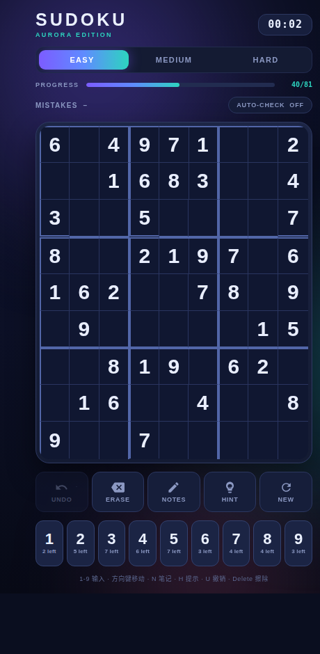

# Sudoku Aurora

A modern, animated Sudoku game for Android, written in pure Java with custom-drawn views — no third-party UI libraries. Puzzles are generated with a **guaranteed unique solution**, and progress is saved so you can close and resume.

| Main screen | Victory screen |
|---|---|
|  |  |

**[Play the interactive HTML preview](sudoku-aurora-preview.html)** — open the file in any modern browser to try the exact UI without installing anything.

## Features

- **Generator with a guaranteed unique solution** — randomized backtracking plus a solution counter that rejects any removal creating ambiguity
- **Three difficulties**: Easy (40 clues), Medium (33), Hard (27)
- **Animated board**: digit pop-in overshoot, wrong-entry shake, staggered puzzle reveal, gradient selection glow, victory light sweep
- **Dark aurora theme**: drifting gradient orbs, star field, violet → teal accents, soft rounded cells
- **Interactive keypad**: big digits with live "N left" counts, spring press animation, haptic feedback, completed digits dim to ✓
- **Physical keyboard**: `1`–`9` to enter, arrows to move, `N` notes, `H` hint, `U` / `Ctrl+Z` undo, `Delete` erase
- Notes / pencil marks, Undo, Erase, Hint, New game, timer, mistake counter, auto-check toggle
- Custom win card with stats and falling confetti; progress saved via `SharedPreferences`
- Adaptive launcher icon in 5 densities

## Install

Download the latest APK from **[Releases](../../releases)**, or use the always-latest file in the repo root:

```bash
adb install -r SudokuAurora.apk
```

Or copy the APK to your phone and open it (enable "Install unknown apps"). Requires **Android 5.0 (API 21)** or newer.

## Updating the app (installs on top)

Every new release **replaces the existing installation in place** — your saved puzzle, timer, settings and stats are kept. Android permits an in-place update only when all three conditions hold:

| Condition | How this project guarantees it | What breaks if you violate it |
|---|---|---|
| **Same `applicationId`** | `com.workbuddy.sudoku` in [`app/build.gradle`](android-app/app/build.gradle) — never change it | The new APK installs as a *second, separate* app |
| **Same signing certificate** | [`android-app/keystore/sudoku-aurora.keystore`](android-app/keystore/sudoku-aurora.keystore), applied to **both debug and release** builds. The certificate SHA-256 is locked in [`scripts/signing-fingerprint.txt`](scripts/signing-fingerprint.txt) and `release.sh` **aborts** if a build produces a different one | `INSTALL_PARSE_FAILED_INCONSISTENT_CERTIFICATES`; users must uninstall first and lose their save |
| **`versionCode` strictly increases** | `release.sh` reads the current value and increments it automatically on every release | `INSTALL_FAILED_VERSION_DOWNGRADE` |

Because the very first APK distributed from this repo was already signed with this exact certificate, **an existing install can be updated directly by a Release APK** — `adb install -r` and plain sideloading both work, no uninstall needed.

### Version history

| Release | `versionCode` | `versionName` | Notes |
|---|---|---|---|
| — | 1 | `1.0` | Initial Sudoku app (not published as a Release) |
| — | 2 | `2.0-aurora` | Aurora UI rewrite, debug APK only |
| **v2.0.0** | **3** | `2.0.0` | First signed GitHub Release; persistent signing key + version automation |

`versionCode` is a monotonic build number and is intentionally decoupled from `versionName`. Never reuse or lower it.

## Cutting a new release

1. Add a `## [X.Y.Z] - YYYY-MM-DD` section to [`CHANGELOG.md`](CHANGELOG.md). **That section is the release notes** — it gets published verbatim to GitHub Releases, so include the install/upgrade instructions users need.
2. Run:

```bash
./scripts/release.sh 2.0.1
```

The script will: increment `versionCode`, set `versionName`, build `assembleRelease`, verify the APK signature **and** that its certificate matches the locked fingerprint, verify `aapt` badging (package / version codes), copy the APK to `SudokuAurora.apk` (always-latest) and `dist/SudokuAurora-vX.Y.Z.apk`, commit and push, then create the GitHub Release with the APK attached and the CHANGELOG section as notes.

Preview a release without publishing anything — it still increments the version, builds the signed APK and verifies the certificate/badging, then restores `build.gradle`:

```bash
./scripts/release.sh 2.0.1 --dry-run
```

**Requirements**: JDK 17, Android SDK with `platforms/android-34` + `build-tools/34.0.0`, Gradle 8.7 (the wrapper, or set `GRADLE=/path/to/gradle`), and `gh` authenticated with the `repo` scope. Environment variables `JAVA_HOME`, `ANDROID_HOME` (or `sdk.dir` in `local.properties`) are used; `local.properties` is intentionally gitignored because it contains a machine-specific SDK path.

To build/test locally without publishing:

```bash
cd android-app && ./gradlew assembleRelease
```

## Signing & security

The signing key is **committed to this repository on purpose**, and its password is the standard public Android debug password (`android`). This guarantees that every clone, every contributor and every CI run produces an APK with the same certificate, which is what makes in-place updates work for everyone.

The trade-off, stated plainly: **anyone can sign an APK with this key**, so it provides authenticity only in the sense of "same origin as your previous install", not "trusted publisher". That is acceptable for personal sideloading, but **not** for a store listing or an app handling sensitive data. If you later rotate to a private key, all existing users must **uninstall once** (losing their saved game) before they can install the new build; after that migration, updates continue to install on top. Do not rotate the key casually.

## Project layout

```
android-app/
  app/src/main/java/com/workbuddy/sudoku/
    MainActivity.java         UI wiring, keyboard, dialogs, save/restore
    SudokuGame.java           game state, undo, notes, hints, win check
    SudokuGenerator.java      unique-solution puzzle generation
    SudokuBoardView.java      custom-drawn animated 9x9 board
    NumberPadView.java        springy interactive keypad
    AuroraBackgroundView.java animated gradient background
    ConfettiView.java         victory particles
    SegmentedControlView.java difficulty selector
  app/src/main/res/           layouts, colors, styles, drawables, icons
  keystore/                   persistent signing key
  keystore.properties         signing credentials
scripts/
  release.sh                  version bump + build + publish
  signing-fingerprint.txt     locked certificate SHA-256
sudoku-aurora-preview.html    playable browser prototype
SudokuAurora.apk              latest signed build
CHANGELOG.md                  release notes source
```

## Verification

- Puzzle generator tested on a plain JVM: exact clue counts (40/33/27), exactly one solution per puzzle, 0–2 ms generation
- Headless-browser interaction test on the HTML preview: 22/22 passing (selection, input, remaining counts, mistakes, undo, hint, erase, notes, difficulty switch, win/confetti)
- Every APK is checked with `apksigner verify` (v1 + v2) and `aapt dump badging` before release
- The sandbox has no emulator or physical device, so the Android UI itself was verified statically and via the 1:1 browser prototype, not on hardware

Built with Android Gradle Plugin 8.5.2 / Gradle 8.7 / compileSdk 34 / minSdk 21.
